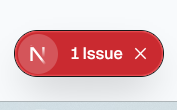
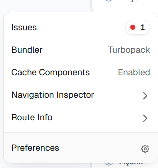
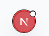
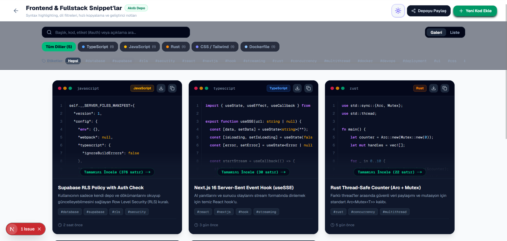
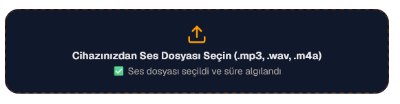

# Anasayfa

* Logonun kenarındaki "container" etiketi kaldırılmalı.
* Çöp kutusu ikonu değiştirilmeli. Üzerindeki kırmızı nokta uyarı bildirimi gibi gözüküyor, bunu istemiyoruz.
* Evrensel Dosya Yükleyici bölümünde aşağıda desteklenen dosya türleri etiketleri çok kalabalık, bunlar kaldırılmalı. Ayrıca oto yönlednirme etiketi de kaldırılmalı.
* Evrensel Dosya Yükleyicinin çalışma mantığı oto yönlendirmeden ziyade tavsiye gibi olmalı. Kullanıcı yüklemekten vazgeçebilir veya sistemin otomatik yönlendirdiği değil de başka bir depoyu kullanmak isteyebilir.
* Yeni Depo Başlat bölümündeki kartların altında yer alan "Hemen Oluştur" ifadesi şu an yanıltıcı çünkü şu anki mantığa göre bu depolar bir kere kurulunca bir yenisi oluşturulamıyor sadece içine yeni şeyler eklenebiliyor. Bu yüzden bu ifadeyi tamamen kaldırmalı ya da sadece daha önce hiç kurulmamışsa göstermeliyiz.
* Manuel sıralama diğer sıralamalarla birlikte aynı listede yer almamalı. İnsanlar manuel sıralamak istediğinde ekranda her zaman var olan tuşlarla veya direkt sürükle bırak yaparak depoların sırasını düzenleyebilmeli. İkinci seçenek zor olabilir bu yüzden birinci seçenek öncelikli.
* Depoların bannerları/kapak reismleri kullanıcı tarafından kurulum aşamasında ve sonrasında belirlenebilmeli/düzenlenebilmeli. Aynı şekilde depo ismi falan da yeniden adlandırılabilir olmalı.
* Şu anki mantığa göre hem standart hem akıllı depolar depo türü olarak birden fazla kez oluşturulamıyor. Bu yüzden yeni kullanıcılar ilk defa kullanacakları depoyu seçtiklerinde bir depo kurulum aşaması olmalı. Deponun adını, açıklamasını, kapak resmini belirleyebilmeli. Kurulum aşamasında seçilen bilgiler sonradan değiştirilebilir olmalı.
* Sıralama filtresi seçeneklerinde A-Z, AZ-ÇOK gibi seçenekler olmak yerine Son güncelleme, Alfabetik, İçerik sayısı şeklinde listelenmeli. Yandaki yukarı/aşağı simge ise pasif bir simge olmaktan çıkartılıp tıklandığında sıralama yönünü filtreye göre azdan çoka-çoktan aza gibi sıralamaya yarayan bir butona çevrilmelidir.

* resim1'de gözüken tıklanabilir buton sadece developer ekranında mı var? sonradan kaldırılacak mı? kullanıcılar için gerekli mi? resim2'de görüldüğü üzere bu butona tıklayınca seçenekler çıkıyor. Aslında çok güzel bir sekme ama işe yarar mı bilmiyorum. Profil mantığını bu butonda olduğu gibi düzenleyebiliriz. profil butonu resim3'teki gibi olur. Tıklanınca sekmeler açılır. Örneğin: Profil, Tema, Güvenlik, Senkronizasyon, Yedek, Paylaşımlar, Çıkış gibi seçenekler olur. Böylece kullanıcı profile tıkladığında bir sürü karmaşık içerik yerine yalnızca ihtiyacına yönelik işlem yapabilir.
* Global arama çubuğu ilk açıldığı anda "Tümü, Filmler..." seçenekler çıkıyor. Ve altta default listelenen içerikler var. Buradaki problemleri sub maddelerde açıklıyorum:
    - Arama sonrası depoya ya da içeriğe tıklamak fark etmeksizin açılan şey deponun kendisi. Depoya tıklandığında depo, içeriğe tıklandığında içerik açılmalı.
    - Arama çubuğundaki filtre etiketleri doğru çalışmıyor. Örneğin film'e tıkladığımda Görsel deposundaki bir içerik de listeleniyor. Diğer etiket filtreleri için aynı sorunun olduğunu görmüyorum ancak sen yine de bunun kontrolünü yap.
    - Bu filtre etiketleri düzensiz/tutarsız. Eğer böyle bir filtre olacaksa en azından sadece 8 depo türünün etiketi olsun. Depo adı da değil direkt türü. Film, Kod, Gezi, Ders, Metin, Ses, Görüntü, Dosya şeklinde.
* Standart depo oluştura tıklanınca hem tab hem de yön tuşları ile 4 tür depo arasında gezinme yapılabilmeli. Zaten oluşturma kısmı olduğu için de devam et seçeneğinden hemen sonra kurulum ekranı gelmeli. Eğer daha önce aynı türde bir depo kurulmuş olma ihtimaline karşın devam et seçeneğinin yanında mevcut depolarda devam et gibi bir seçenek eklenmeli.
* Akıllı depolar özel olduğu için aynı tür akıllı depolar şimdiki mantığa göre birden fazla oluşturulamıyor sanırım. Şimdilik bu mantığı bozmayalım. Ancak kullanıcı yine de yeni depo başlat bölümünde zaten kurulmuş bir akıllı depoyu tekrar kurmak için tıklıyorsa kullanıcıya bir uyarı mesajı verilmeli. Ve mevcut depoyla devam et ile mevcut depoyu sil/üzerine yaz gibi bir seçenek sunulmalı.
* Kilitli bir depoya tıklandığında açılan pin penceresi esc tuşu ile kapatılabilmeli. Yani vazgeç butonu ile aynı işleve sahip olmalı.
* Kilitli bir depoya tıkladığımda şifre ekranı önce dolu geliyor. Silip yazmam gerekiyor. PIN yazma ekranı boş gelmeli ve yanlış yazdığımda da yazdıklarım sıfırlanmalı direkt olarak doğrusunu yazmak için fırsatım olmalı.

# Film Dizi Deposu

* Anasayfa için belirttiğim filtreleme ve sıralama mantığı bu depo içinde de kurulmalı. İsim, puan, yıla göre vb. sıralama seçeneği olmalı ve yandaki pasif filtre butonu anasayfadaki aşağı yukarı yönlü simge ile değiştirilmeli ve aktif hale getirilmelidir.
* Kullanıcılar film puanından bağımsız olarak basit bir eğlenceli puanlama sistemi kullanabilmeli. Kart üzerinde tıklanarak değişen metin ya da 1'den 3'e kadar olan yıldız simgeleri aracılığıyla bir değerlendirme yapılmalı. Değerlendirme mantığı: tek tıklama (*)-> iyi, Çift tıklama --> Kötü (**), Üç tıklama (***)-> Çirkin şeklinde bir mantık ama tam olarak böyle değil. Detaylar aşağıda:
    - İlham alınan yer: İyi, Kötü, Çirkin filminin adı
    - Mantık: Üç farklı tıklama üç farklı değerlendirmeyi ifade edecek.
    - Puanlama değil, değerlendirme olacak. Dolayısıyla tıklama sayılarının birbirlerine üstünlüğü olmayacak.
    - İyi ve Kötü bu değerlendirmesi kullanışlı olsa da Çirkin kelimesi film değerlendirmesi için Kötü kelimesiyle benzer anlam yaratıyor. Alternatif bulunması ve iyi bir üçlü değerlendirme kombinasyonu seçilmesi gerekiyor.
    - Yıldızdan ziyade seçilen her değerlendirme kelimesi için bir simge seçilmeli. Kartın üzerindeki uygun bir yerde bir buton aracılığıyla her tıklamada seçilecek değerlendirmeye göre simge değişmeli. Eğer daha önce film kullanıcı tarafından bu şekilde hiç değerlendirilmediyse bu simgelerden hiçbiri gözükmemeli, default bir simge olmalıdır. Bu default simge bir başlangıç butonu veya daire gibi olabilir. Eğer kullanıcı değerlendirmesini geri almak isterse 4. tıklamada ilk haline yani değerlendirilme yapılmamış olan default duruma dönmeli.
* Search çubuğunun yanına bir filtre butonu eklenebilir. Nelerin filtreleneceği kararını vermedim. AI bunun kararını verebilir.
* Filmlere tıklandıktan sonra açılan pencerede -mümkünse görselin üzerinde bir yerde- fragmanı izle butonu olmalı. şu anlık bu buton pasif olabilir. ölçeklik kazanmak için ekleyeceğiz. Ancak özellik aktif olmadığı için bu buton üzerine gelindiğinde "bu özellik henüz aktif değil" yazan bir notice veya developerlıkta buna ne deniyor o şey eklenmeli.
* Bir film izlenmeden favorilere eklenememeli. Aynı anda hem izlendi hem de izleme listesinde gözükmemeli.
* Arşivi indir özelliği korunmalı ancak şu anda pasife alınmalı. Çünkü json pek de kullanışlı değil.
* Manuel film kaydı yapıldığında film kartına yerel kayıt etiketi eklenmeli.
* Yerel kayıt ile eklenen filmlere ait bilgiler kayıt ekranındaki gibi haliyle güncellenebilmeli.
* Kullanıcı yerel kayıttan film eklerken 3.2 gibi ara bir puan değeri girerken nokta yerine virgül kullansa bile sistem bunu anlayıp arkaplanda virgülü nokta ile değiştirip kaydı yapmalı. Şu an virgül ile eklendiğinde direkt puan tam sayıya yuvarlanıyor.
* Arşiv indirilince json olarak dışa aktarıldı gibi bir şey beliriyor ve geri alma butonu var. Bu özelliği tamamen kaldırmamız gerek çünkü kullanıcı indirdikten sonra istesek de geri alamayız zaten. arşiv indirme özelliği pasife alınmadan önce bu özellik kaldırılmalı.
* Film ve dizi deposu yaptık ama buradan dizi ifadesini tamamen çıkaralım. Anasayfanın bir bölümünde planlanan çalışmalar/eklenmesi planlanan özellikler/devam eden çalışmalar gibi bir kısım yapıp oraya da bir dizi deposu kartı koyarız. ya da diğer planlı özellikler de oalcağı için daha uygun bir format olur o konuda kararı sana bırakıyorum.
* Arşiv'i indir gibi kaydı indir seçeneği de pasife alınmalı.
* Depoya girince içerikleri paylaşabiliyoruz ancak depoyu paylaş butonu yok.

# Kod Parçacıkları Deposu

* temaKP'de görüldüğü üzere bu depo light mode'da çalışırken görsel/renksel/okunabilrlik açısından tutarsızlık yaratıyor. Ve kullanıcı deneyimini kötü etkiliyor. Bunun düzeltilmesi gerek. Not: Koyu temada sorun yok.
* Etiketlerin filtre gibi kullanılmasına gerek yok tamamen kaldıralım. Dolayısıyla bu etiket filtrelerinin altındaki kaydırma çubuğuna da ihtiyacımız kalmıyor.
* Yeni kod eklerken de Etiketler yerine Anahtar kelimeler bölümü olsun. Günümüzde hashtaglerin kullanım ömrünü yitirdiğine inanıyorum.
* Kod eklerken bir ister de Github bağlantısı olsun. Ama zorunlu tutulmasın. Bu sebeple kartların üzerine bir github simgesinin yer aldığı buton eklensin. Eğer github linki eklendiyse bu buton aracılığıyla yeni sekmede ilgili github linki açılsın.
* Yeni kod ekle ve kod parçacağını düzenle pencereleri esc tuşuyla kapatılabilmeli. Ancak bir değişiklik varsa esc'ye basınca yine de vazgeçmek istiyor musunuz gibi bi uyarı sorusu çıkmalı.
* Depoyu paylaşa tıkladığımda içerik silinmiş uyarısı geliyor ancak ben depo içinde aktif olarak gezinebiliyorum ve iş yapabiliyorum. Paylaşım sorunu düzeltilmeli. İçerikleri paylaşırken de milisaniyeler içinde aynı uyarı geliyor ama sonrasında içeriğin paylaşım ekranı düzgün olarak görüntüleniyor.
* İndirme butonuna tıklandığı anda indirildi bildirimi geliyor ancak gerçekten indirilmediğinde bile bu bildirim geliyor. Çünkü indire tıkladığımda indireceğim klasörü seçiyorum ama bu aşamada vazgeçiyorum yine de indirildi bildirimi ekrana geliyor. Gerçekten klasörü seçip indirsem bile indirme bitmeden iptal de edebilirim. Sistem bildirimi buna uygun değil. Ya gerçekten bildirim doğru olsun ya da bu bildirim hiç gelmesin.

# Gezi Deposu

* İçerikler tıkklandığında açılan pencere esc tuşuyla kapatılabilmeli.
* Yukarıdaki 4 KPI kartı neye göre ölçülüyor öğrenmem lazım.
* Diğer bölümlerdeki "sırala" mantığı burada da uygulanmalı.
* İçerikler favori olarak işaretlenebiliyor ama favorileri bir arada göremiyoruz. Buna yönelik bir çözüm uygulanmalı.
* Depo paylaşıldığında içerik silinmiş uyarısı geliyor ama depo mevcut. Düzeltilmesi gerek. İçerik paylaşımında da anlık olarak aynı uyarı geliyor ama hemen sonrasında düzgün görüntüleniyor. Bu uyarı yalnızca milisaniyeler içinde ekranda kalıyor.
* Yeni bir rota kaydedileceğinde kayıt ekranında hem arkaplan hem de metinler beyaz olduğu için okunabilirlik zayıf. 
* Rota kayıt ekranında kategori seçiminde seçenekler arasında küçük ikonlar var ama yanlarında kategori isimleri yazıyor mu bilmiyorum. Eğer beyaz font kullanılmışsa yine okunabilirlik yok.
* Rota kayıt ekranında şehir ve ülke seçimi için güvenilir bir kaynaktan ülke ve şehir isimleri çekilmeli. Manuel olarak yazmanın dışında şehir ve ülkelerin bulunması kolaylaştırılmalı.
* Tema light iken fontlarda okunabilirlik sorunu yok. Çünkü yazılar siyah. Ama tema dark mode olunca normal sayfa dark modda çalışıyor ama rota kayıt ekranı arkaplanı beyaz olarak kalıyor ve yazılar da beyaz olduğu için okunmuyor.
* Aynı okunabilirlik sorunu arama çubuğunda da var.
* Md olarak indirme özelliği pasife alınmalı.

# Ders Deposu
* Gezi deposundaki okunabilrilik sorunlarının aynıları mevcut.
* Övgü: Eğer çalışma kartlarını (flashcard) otomatik üretilen bi özellik olarak eklediysen bu çok iyi.
* Depo paylaşımındaki içerik silinmiş sorunu mevcut.
* Md olarak indirme özelliği kaldırılmalı. Dosya türü ne ise o türde indirilmeli.
* Ayrıca şu an özel olarak dokümanı indirme kısmında doküman indirilince sadece başlığın yazılı olduğu 1 sayfa indiriliyor bu düzeltilmeli.
* Dokümanı aç butonuna tıklayınca gerçekten ilgili dokümana ait bir önizleme çıkmalı default bir görsel değil.
* Kartları indir'e tıklayınca inen dosya hangi türde? Örneğin vs code ile açınca yine sadece başlığı içeren bir içerikle karşılaşıyorum. Bunu istemiyorum. Daha mantıklı bir şey yoksa özellik pasife alınmalı.
* Daha önce bahsedilen "Sırala" mantığı buraya da uygulanmalı.
* PDF dışında pdf, docx vb. dosya türleri de desteklenmeli.
* pptx için mümkünse özel bir oynatım özelliği eklenmeli. eklenemiyorsa belirtilmeli.

# Metin Deposu

* Sanırım dark mode okunabilrilik sorunu her depoda var artık tekrarlamayacağım.
* Klasörlerin ve içeriklerin listelendiği sol sekmede aynı vs code gibi platformlarda olduğu gibi klasöre tıklandığında altındakilerin listelendiği bir yapıda olmalı. Açılan listedeki içerik sürükle bırak ile bir diğer klasöre taşınabilmeli.
* esc mantığı eklenmeli.
* Depoya girince depoyu paylaşabilme seçeneği yok. Eklenmeli. Ayrıca klasörlere de paylaşım seçeneği getirilmeli. İçeriklerin paylaşım seçeneği zaten var.

# Ses Deposu

* Depo paylaşımdak içerik silinmiş sorunu burda da var. Genel bir sorun gibi bunu da tekrarlamayacağım artık.
* Hashtagler kaldırılmalı.
* Ses dosyası paylaşılınca kartın ekranında oynatma işareti var. Tıklayınca çalıştığı belli oluyor ama ses gelmiyor. Normal depo içinde ses geliyor.

* Bu depoda ve diğer depolarda eğer yerelden yüklenecek herhangi bir dosya varsa "kayit" adlı resimdeki gibi içeirk seçilese de seçilmese de "dosya seçildi ve algılandı" uyarısı geliyor. Bu olmasın hatta hangi dosya seçildiyse seçildikten sonra o kart/bölüm sadece onun adının yazdığı bir görüntüye kavuşsun ki dosyanın başarılı olarak yüklendiği sezgisel olarak anlaşılmış olsun.
* esc mantığı buraya da eklenmeli. birçok yerde istiyorum bu yüzden artık bu özelliği de tekrarlamayacağım.

# Görsel Deposu
* Çözünürlüğün kullanıcı tarafından girilmesi gerçekçi değil otomatik algılanmalı. Aynı şekilde format da öyle. Eğer desteklenmeyen bir format yüklenirse uyarı verilmeli.

# Belge Deposu
* Gerçekten indirmesem bile sağ altta indirildi bildirimi burda da karşıma çıkıyor.
* Önzilemeler metin değil de dosyaların gerçek formatına uygun olmalı.
* PPTX içeriği indirince ve power pointte açmaya çalışınca "çalıştıramaz" gibi bir uyarı aldım. Aynı şekilde diğer tür dosyalra da açılamıyor "geçreisz" gibi uyarılar alıyorum. Gerçek kullanıcı dosya yüklendiğinde böyle olmaz umarım.
* Format ve boyut gibi özellikler dosyaya göre otomatik algılanmalı.
* Belge içi önizleme metni kaldırılıp belgenin orijinal önizlemesi görüntülenmeli (ilk sayfasının bir kısmı gibi)

# Çöp Kutusu
* Süresi dolduğunda bir içerik gerçekten siliniyor mu yoksa bir uayrı ile beraber orada mı kalıyor bunu test edemedim. Kontrolünü yap. Olması gereken süresi dolduktan sonra sistemden kalıcı olarak bu içierğin otomatik olarak silinmesi.

# Profil

## Profil Kartı
* Kullanıcı kendi profil resmini yükleyebilmeli ve dilediğinde kaldırabilmeli. Eğer profil resmini kaldırırsa şu anki default haline geri dönmeli.
* E-postanın değiştirilemez olması kötü bir mantık. Bunun yerine e-posta doğrulaması getirilmeli. Ve dilendiğinde doğrulama koduyla e-posta değiştirilebilmeli.
* "💡 Not: Platform sosyal medya olmadığı için biyografi (bio), takipçi ve benzeri alanlar bulunmamaktadır." Notu kaldırılmalı. Kullanıcnın bir şeyin neden olmadığına yöönelik bilgiye ihtiyacı yok.
* Tüm arşivi json olarak indirme yöntemi pasife alınmalı. İleride 

## Görünüm ve Tema Tercihi
* burada sıkıntı yok

## Master PIN
* Akıllı depolar da PIN ile kilitlenebilmeli. Film deposuna girince bunu gördüm ama depo oluşturma kısmıdna film deposuna basınca içerisine otomatik girdiği için işe yaramıyor ayrıca depo içiinde korumlaı hale getirsek bile bu sadece görüntüsel olarak oluyor. Sadece altta depoların listelendiği kısımda açıktan kilitli hale getirdiğimde gerçekten kilitleniyor. Belgede daha önce belirttiğim depo kurma ve açma mantıklarına uygun olarak bu özellik düzeltilmeli.

## Bulut Veritabanı ve Senkronizasyon (Supabase)
* "Yerel mod aktif: Verileriniz yerel tarayıcı hafızasında güncellendi." diyor buluta eşitle diyince ayrıca "🟡 Yerel Mod (Offline / PWA)" bildirimi de var. Bu ne demek? Proje canlıya alınmadığı veya supabase ile henüz gerçek bir bağlantı kurulmadığı için mi böyle?

## Tam Arşiv Yedekleme & Geri Yükleme (.json)
* Bu özellik şimdilik pasife alınsın.

## Paylaşılan İçerikler
* Sıkıntı yok gibi duruyor.

# Sign In/Up

* Yeni bir hesap açsam da ad-soyad, e-posta, şifre girdikten sonra açılan hesapta bizim admin olarak kullandığımız hesaptaki tüm içeriklerin aynısı oraya da geliyor. auth kontrolü hiçbir şekilde yok.
* Google ile giriş yap dediğimde kayıtlı google hesaplarım seçenek olarak çıkmıyor direkt olarak admin hesabı açılıyor.
* Yeni açtığım deneme hesbaının bilgileirni login ekranında kayıtlı şifreler yardımıyla girince oturum aç butonuna basmadan direkt olarak buton çalışıyor gibi gözüküyor ama hiçbir şey açılmıyor. Sayfayı yenileyince buton tekrar basılablir hale geliyor ve normal çalışıyor.
* Yetki kontrolü, bireysel hesap mantığı yerleştirilmeli. Herkes aynı içeriğe sahip olmamalı. Her kullanıcı yalnızca kendi hesabındaki depolara erişebilmeli.
* Hesaba giriş yapılmasa bile url değiştirilerek siteye bağlı bağlantılar ve sayfalar açılabiliyor. Düzeltilmeli.

# PASİFE ALINAN ÖZELLİKLER
Bu özellikleri bir yerde tut. İleride lazım olabilir. 
------------------------------------------------------------------------------------------------------------------------------------------------------------------------