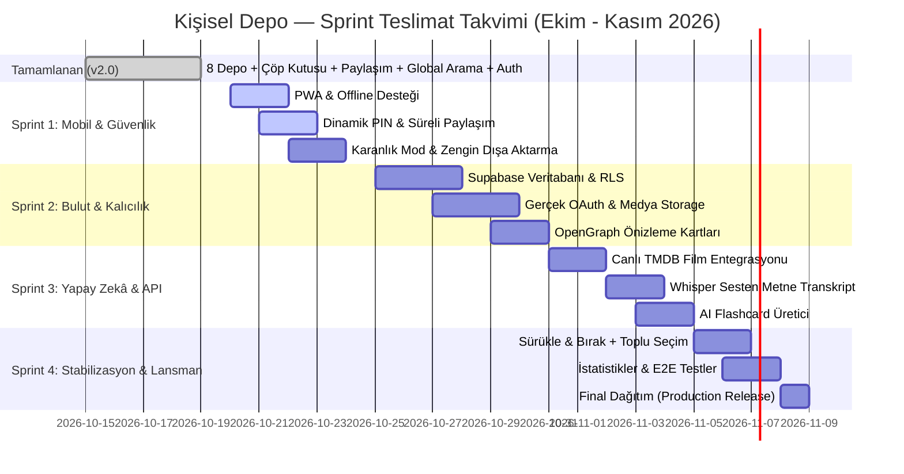

# Kişisel Depo — Scrum Sprint Planı & Yol Haritası (Agile Sprint Roadmap)

**Proje:** Kişisel Dijital Depo (Personal Storage Container)  
**Metodoloji:** Agile / Scrum (Hızlı Micro-Sprint Döngüleri)  
**Hedef Lansman (Release Target):** 8 Kasım 2026 (~3 Haftalık Hızlı Teslimat)  

---

## 👥 Roller ve Sorumluluklar

| Rol | Sorumlu | Temel Odak |
| :--- | :--- | :--- |
| **Product Owner (Müşteri)** | **Siz (Kullanıcı)** | İş önceliklerini onaylama, kabul kriterlerini değerlendirme, özellik yönlendirmesi. |
| **Scrum Master** | **Antigravity** | Sprint planlama, görevleri parçalama, blokajları kaldırma, mimari standartları koruma. |
| **Development Team** | **Antigravity & Subagent Ekipleri** | Kod yazımı, UI/UX tasarımı, test otomasyonu, entegrasyonlar. |

---

## 📊 MoSCoW Önceliklendirme Matrisi

- 🔴 **Must Have (Mutlaka Olmalı):** Dinamik PIN/Şifreleme, PWA Mobil Kurulumu, Bulut Veritabanı (Supabase) ve Gerçek Medya Yükleme.
- 🟡 **Should Have (Olsa Çok İyi Olur):** Canlı TMDB API, Süreli/Şifreli Paylaşım Linkleri, Karanlık Mod, Sürükle & Bırak.
- 🟢 **Could Have (Zaman Kalırsa):** AI Transkript (Whisper), AI Flashcard Üretici, Spotify Wrapped tarzı Kişisel Hafıza İstatistikleri.
- ⚪ **Won't Have (Bu Sürümde Yok):** Sosyal medya akışları, takipçi/beğeni mekanizmaları (Kişisel depo felsefesi gereği kapsam dışı).

---

## 📅 Sprint Takvimi & İş Dağılımı

---

## 🏃 Sprint Detayları

### 🔹 Sprint 1: Mobil Deneyim, PWA ve İleri Düzey Güvenlik
**Tarih Aralığı:** 20 Ekim – 24 Ekim 2026 (4 İş Günü)  
**Hedef:** Uygulamayı cebe indirilebilir (PWA) hale getirmek, şifreleme ve süre kısıtlı paylaşım özelliklerini eklemek.

| ID | Görev / User Story | Puan | Öncelik | Kabul Kriteri (DoD) |
| :--- | :--- | :---: | :---: | :--- |
| **SP1-1** | **PWA (Progressive Web App) Kurulumu** | 5 | 🔴 Must | Telefonda "Ana Ekrana Ekle" butonu çalışmalı, çevrimdışı önbellekleme aktif olmalı. |
| **SP1-2** | **Dinamik Depo PIN Belirleme & Kriptolama** | 5 | 🔴 Must | Kullanıcı 1234 yerine kendi 4-6 haneli PIN'ini belirleyebilmeli, yanlış denemede kilitlenmeli. |
| **SP1-3** | **Süreli ve Parolalı Paylaşım Linkleri** | 3 | 🟡 Should | Paylaşırken "24 saat sonra kapansın" veya "Şifre girilerek açılsın" seçilebilmeli. |
| **SP1-4** | **Karanlık Mod (Dark Mode) Desteği** | 3 | 🟡 Should | Tek tıkla OLED uyumlu gece moduna geçiş, sistem temasına otomatik uyum. |
| **SP1-5** | **Zengin Dışa Aktarma (.md, .pdf, .zip)** | 3 | 🟡 Should | Şiirler/notlar `.md` veya `.pdf`, kodlar `.py`/`.ts` olarak tek tıkla indirilebilmeli. |

---

### 🔹 Sprint 2: Bulut Veritabanı, Medya Storage & Gerçek Kalıcılık
**Tarih Aralığı:** 25 Ekim – 30 Ekim 2026 (6 İş Günü)  
**Hedef:** Tarayıcı hafızasını bulut altyapısıyla (Supabase) desteklemek ve gerçek dosya/medya yüklemesini açmak.

| ID | Görev / User Story | Puan | Öncelik | Kabul Kriteri (DoD) |
| :--- | :--- | :---: | :---: | :--- |
| **SP2-1** | **Supabase PostgreSQL & RLS Şeması** | 8 | 🔴 Must | 8 depo için tablolar oluşturulmalı, kullanıcı sadece kendi verisini okuyabilmeli. |
| **SP2-2** | **Bulut Medya Depolama (Storage Bucket)** | 8 | 🔴 Must | Kullanıcı gerçek MP3 ses kaydı, yüksek çözünürlüklü görsel ve PDF yükleyebilmeli. |
| **SP2-3** | **Gerçek OAuth Sağlayıcıları** | 5 | 🔴 Must | Google ve GitHub hesapları ile tek tıkla gerçek yetkilendirme. |
| **SP2-4** | **Dinamik OpenGraph (OG Meta Tags)** | 3 | 🟡 Should | `/share/[token]` linki WhatsApp/Twitter'da paylaşıldığında zengin önizleme kartı çıkmalı. |

---

### 🔹 Sprint 3: Yapay Zekâ (AI) ve Akıllı Dış API Entegrasyonları
**Tarih Aralığı:** 31 Ekim – 4 Kasım 2026 (5 İş Günü)  
**Hedef:** Depoları otomatik içerik üreten akıllı asistanlarla güçlendirmek.

| ID | Görev / User Story | Puan | Öncelik | Kabul Kriteri (DoD) |
| :--- | :--- | :---: | :---: | :--- |
| **SP3-1** | **Canlı TMDB Film & Dizi Arama API** | 5 | 🟡 Should | Film adı yazılırken TMDB'den otomatik tamamlama, gerçek afiş ve detay çekme. |
| **SP3-2** | **Whisper AI Ses Transkript Motoru** | 8 | 🟢 Could | Ses deposuna eklenen kaydın otomatik olarak Türkçe metin dökümünün çıkarılması. |
| **SP3-3** | **Ders Notlarından Otomatik Flashcard Üretici** | 5 | 🟢 Could | Eklenen özetten Gemini/AI ile tek tıkla 5 adet çalışma soru-cevabı üretme. |

---

### 🔹 Sprint 4: Sürükle & Bırak, Analitik, E2E Testler & Lansman
**Tarih Aralığı:** 5 Kasım – 8 Kasım 2026 (4 İş Günü)  
**Hedef:** Tam stabilizasyon, toplu yönetim jestleri ve üretim sürümünün yayını.

| ID | Görev / User Story | Puan | Öncelik | Kabul Kriteri (DoD) |
| :--- | :--- | :---: | :---: | :--- |
| **SP4-1** | **Sürükle & Bırak (Drag & Drop) ve Toplu Seçim** | 5 | 🟡 Should | Dosyaları klasörlere sürükleyebilme, birden çok öğeyi tek seferde silebilme. |
| **SP4-2** | **Kişisel Hafıza İstatistikleri (Wrapped)** | 3 | 🟢 Could | "Bu ay 12 film izledin, 4 ses kaydettin" özet analitik paneli. |
| **SP4-3** | **Playwright E2E Otomatik Test Paketi** | 5 | 🔴 Must | Tarayıcı üzerinde baştan sona giriş, arama, ekleme ve paylaşım testleri. |
| **SP4-4** | **Canlı Dağıtım (Production Release v2.1)** | 3 | 🔴 Must | Vercel üzerinde canlı ortam yayını ve son kontroller. |

---

## 📌 Bitti Tanımı (Definition of Done - DoD)
Bir görevin tamamlanmış ("Done") kabul edilmesi için aşağıdaki kriterleri sağlaması zorunludur:
1. İlgili TypeScript kodlarının `npm run build` ile sıfır hatayla derlenmesi.
2. Otomatik birim testlerinin (`npm test`) başarıyla geçmesi.
3. Mobil ve masaüstü tarayıcılarda görsel responsive testinin yapılmış olması.
4. Kodların GitHub ana dalına (`origin/main`) temiz commit mesajıyla gönderilmesi.
5. Müşteriye (Product Owner) canlı çalışır örneğin sunulması ve onay alınması.
